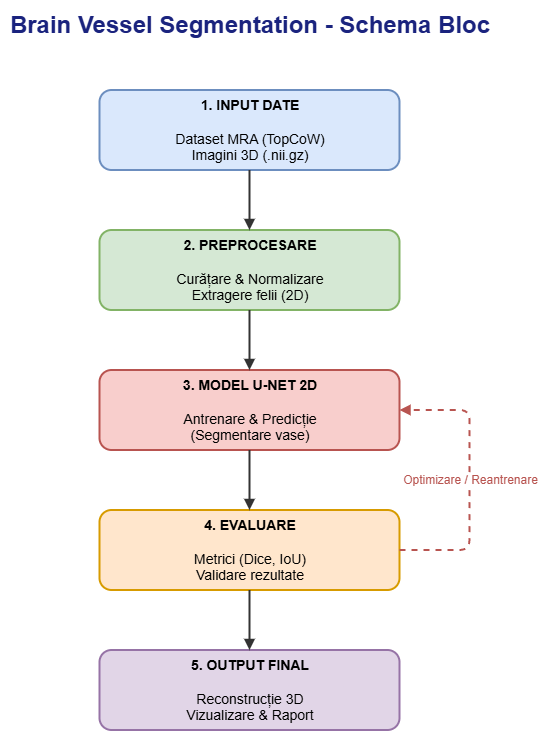

                                                    Brain Segmentation : segmentarea arterelor cerebrale

| Nr. | Autor(i) / An | Titlul articolului / proiectului | Aplicație / Domeniu | Tehnologii utilizate | Metodologie / Abordare | Rezultate | Limitări | Comentarii suplimentare |
|:---:|:---|:---|:---|:---|:---|:---|:---|:---|
| 1 | Ronneberger, Fischer & Brox / 2015 | U-Net: Convolutional Networks for Biomedical Image Segmentation | Segmentare biomedicală generală | CNN, U-Net | Arhitectură encoder-decoder simetrică, cu conexiuni skip; antrenare end-to-end cu puține date anotate. | Performanțe ridicate în segmentarea structurilor biomedicale; rezultate raportate pe setul ISBI. | Arhitectură 2D, fără context volumetric; nu este proiectată specific pentru vase mici. | Arhitectură fundamentală pentru proiecte de segmentare medicală. |
| 2 | Isensee et al. / 2021 | nnU-Net: a self-configuring method for deep learning-based biomedical image segmentation | Segmentare medicală automată | U-Net 2D/3D, auto-configurare | Configurare automată a preprocesării, arhitecturii, antrenării și postprocesării. | Rezultate competitive pe 23 de seturi de date publice, inclusiv BraTS. | Poate necesita resurse computaționale ridicate și timp de antrenare. | Poate fi utilizat ca metodă de referință (baseline) pentru segmentarea vasculară. |
| 3 | Yang et al. / 2023 (TopCoW Challenge) | Benchmarking the CoW with the TopCoW Challenge: Topology-Aware Anatomical Segmentation of the Circle of Willis for CTA and MRA | Segmentarea arterelor cerebrale – cercul lui Willis | CTA, MRA, deep learning | Evaluare pe 125 de pacienți cu CTA și MRA; anotări voxel-level pentru 13 componente vasculare; evaluare topologică. | Performanțe ridicate pentru componentele majore ale cercului lui Willis; rezultate mai slabe pentru arterele comunicante. | Arterele comunicante și variantele anatomice rare sunt dificil de segmentat; pot apărea erori topologice. | Set de date și benchmark relevante pentru segmentarea și identificarea anatomică a arterelor cerebrale. |
| 4 | van Voorst et al. / 2026 | Deep generative models for vessel segmentation in CT angiography of the brain | Segmentarea vaselor cerebrale în CTA | GAN, CTA, filtru Frangi | Abordare semi-supervizată, cu GAN condiționat pentru traducerea CTA în NCCT și funcție de pierdere bazată pe filtrul Frangi 3D. | DSC = 0,74 pentru abordarea semi-supervizată, comparativ cu DSC = 0,78 pentru nnU-Net supervizat. | Necesită un set mare de imagini CTA neetichetate; performanță mai scăzută decât metoda supervizată în rezultatele raportate. | Abordare utilă pentru investigarea metodelor care reduc dependența de anotările manuale. |
| 5 | Articol de analiză TOF-MRA / 2026 | Analysis of major segmentation models for intracranial artery time-of-flight magnetic resonance angiography images | Segmentarea arterelor intracraniene pe imagini TOF-MRA | TOF-MRA, U-Net, LinkNet, FPN, PSPNet, DeepLabV3+ | Compararea a 45 de combinații encoder-decoder (9 backbone-uri x 5 arhitecturi); analiză a stabilității folosind coeficientul de variație. | Evaluare pe patru seturi de date: in-house, CereVessMRA, IXI și ADAM; analiză a performanței și eficienței computaționale. | Limitările nu sunt precizate în informațiile furnizate. | Relevant pentru compararea arhitecturilor și justificarea alegerii modelului de segmentare. |

Proiectul are ca obiectiv segmentarea automată a arterelor cerebrale din imagini medicale MRA 3D.   

Descrierea componentelor din Schema Bloc:

1.Input Date:
Modulul responsabil cu achiziția și încărcarea volumelor 3D MRA în format NIfTI (.nii.gz). Aici se utilizează dataset-ul public TopCoW, care oferă imagini și adnotări de specialitate.

2.Preprocesare:
Pregătește datele brute pentru modelul de inteligență artificială. Include operațiuni critice precum eliminarea craniului, normalizarea intensității pixelilor și conversia volumelor 3D în felii 2D pentru a fi procesate de rețea.

3.Model U-Net 2D:
O rețea neuronală convoluțională cu arhitectură encoder-decoder, antrenată să recunoască modelele vizuale ale vaselor de sânge. Aceasta primește felile 2D și generează măști de segmentare (probabilitatea ca un pixel să facă parte dintr-un vas).

4.Evaluare:
Modulul care măsoară performanța modelului. Folosește metrici standard în imagistica medicală (precum Dice Coefficient și IoU) pentru a compara predicțiile modelului cu adnotările reale făcute de medici. O buclă de feedback permite reantrenarea modelului dacă rezultatele nu sunt satisfăcătoare.

5.Output Final:
Transformă rezultatele 2D înapoi într-un volum 3D complet. Acest modul generează hărțile vasculare finale, elimină zgomotul și produce vizualizările necesare pentru analiză clinică sau raportare.
